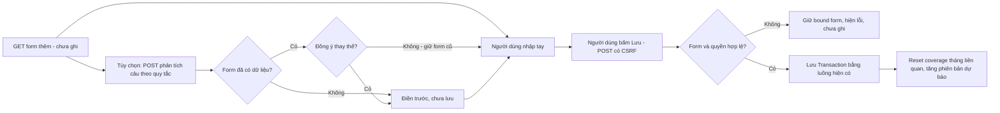
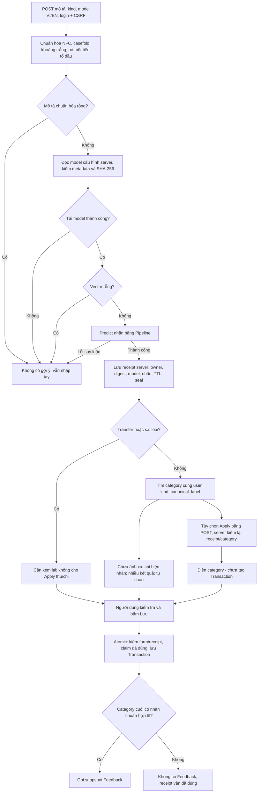
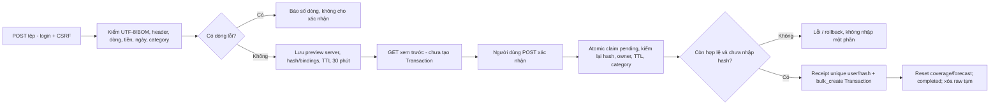
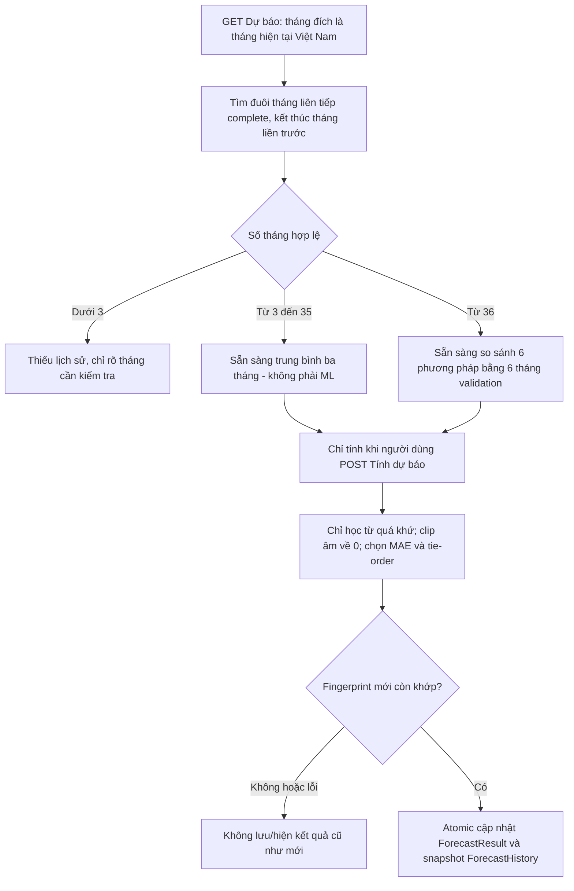

# Luồng nghiệp vụ và dữ liệu ML

TASK 21B, **30/10/2026**, đối chiếu main `c628a642077ccc26db4c6e1ddc1349b67f4c57e9`. Chỉ mô tả mã hiện có, không thực thi request, mở database, đọc .env/credential hoặc huấn luyện. Các quyết định/phiên bản nghiên cứu xem [ml-evidence-summary.md](ml-evidence-summary.md); quan hệ bảng xem [system-architecture.md](system-architecture.md).

## 1. Thêm giao dịch thủ công và nhập nhanh

- `transaction_edit` nhận `request.user`; TransactionForm chỉ có kind, amount, date, category, description. Khi tạo mới, instance.user do server đặt; không có user_id đích từ form. Category queryset theo user, Model.clean kiểm lại chủ/loại. Tiền qua VNDAmountField → Decimal, nguyên đồng dương trong giới hạn hiện có.
- Không có receipt ML: `save_with_feedback` gọi form.save bình thường, không cần tải model hoặc sinh feedback. JS hỗ trợ định dạng/đang gửi, không thay validation/CSRF/transaction phía server.
- Nhập nhanh dùng parser quy tắc: chỉ POST phân tích sau nút bấm, chưa tạo giao dịch/gợi ý ML. Các dấu hiệu tiền/ngày rõ ràng và lỗi mơ hồ theo tài liệu; không đoán danh mục. Nếu hủy thay thế thì form cũ giữ nguyên; nếu chấp nhận thì điền các trường và xóa danh mục/gợi ý cũ. Khi JavaScript tắt, form thường vẫn dùng được.
- Giao dịch CRUD/CSV giữ chính sách ngày của chúng; không suy rằng tất cả form đều chặn ngày tương lai chỉ vì luồng định kỳ/tiết kiệm có chặn.

Nguồn: [views.transaction_edit#L191](../finance/views.py#L191), [forms.TransactionForm#L79](../finance/forms.py#L79), [money_fields.py](../finance/money_fields.py), [classification_feedback.save_with_feedback](../finance/classification_feedback.py), [quick_entry_views.py](../finance/quick_entry_views.py), [quick-entry.js](../static/js/quick-entry.js), [quick-transaction-entry.md](quick-transaction-entry.md).

## 2. Gợi ý → Apply → Lưu → phản hồi

Các nhánh lỗi validation hoặc receipt không hợp lệ dừng **trước khi lưu**, render lỗi và bỏ UUID không còn hợp lệ trên form. Người dùng có thể yêu cầu mới hoặc kiểm tra rồi tự bấm Lưu lần nữa theo luồng thủ công. Không âm thầm chuyển VI sang EN khi lỗi, không huấn luyện trong request phân loại.

### Các khái niệm khác nhau

| Khái niệm | Trường/điểm quyết định | Không được suy ra |
|---|---|---|
| Nhãn mô hình gợi ý | `predicted_label` của receipt do server suy luận, 17 nhãn chung | Không phải category bắt buộc hoặc “nhãn đúng” |
| Danh mục cuối | `Transaction.category` do người dùng kiểm tra/chọn và server xác minh | Tên giống nhãn không tự tạo ánh xạ; chưa ánh xạ vẫn ghi giao dịch |
| Đã bấm Apply | `applied_at` phía server; feedback `applied=True` nếu đã có lần Apply hợp lệ | Không có nghĩa người dùng giữ nguyên lựa chọn đó đến lúc Lưu |
| Cùng/khác nhãn cuối | Feedback `same_label`, so nhãn gợi ý với nhãn chuẩn category cuối | Không bấm Apply nhưng chọn cùng nhãn không gọi là chấp nhận; khác nhãn không tự gọi mô hình sai |
| Phản hồi | Snapshot model/hash, nhãn dự đoán, tên/nhãn category cuối, trạng thái Apply khi lưu thành công | Không phải accuracy, dữ liệu nhãn chuẩn đã duyệt hoặc đầu vào tự học |

Server bind receipt với HMAC của **`[description.strip(), kind, mode]`**, source transaction khi sửa, model identity/hash và seal; đây là kiểm đầu vào form, **không chỉ dùng văn bản sau chuẩn hóa ML**. Tiền/ngày không phải đặc trưng phân loại. UUID giả, khác chủ, hết hạn **15 phút**, revoked, bị sửa seal hoặc không khớp đầu vào bị từ chối. Frontend vô hiệu khi đổi mô tả/loại/chế độ; backend kiểm lại khi Apply và Lưu, không tin hidden label/version/flag do trình duyệt gửi.

Claim compare-and-set `consumed_at`, khóa/tái đọc category và lưu Transaction/Feedback ở cùng transaction. Gửi lại cùng receipt hợp lệ đã lưu trả về giao dịch cũ; dữ liệu lỗi/rollback không tạo feedback mồ côi. Cơ chế receipt này **không phải tuyên bố mọi POST thêm thủ công không có receipt đều được chống trùng bằng database**. Khi chưa có model vẫn lưu tay không receipt được.

Nếu Apply rồi đổi category, feedback ghi category/nhãn **cuối cùng** và vẫn ghi nhận đã bấm Apply trước đó. Các chỉ số cùng/khác nhãn và số Apply có thể giao nhau. Không lưu mô tả vào hai bảng ML; không xuất decision score thành phần trăm. Sửa giao dịch về sau không sửa snapshot cũ; gợi ý mới hợp lệ có thể tạo sự kiện mới khi lưu. Xóa transaction/account cascade phản hồi; đổi/xóa category hợp lệ không viết lại snapshot tên/nhãn. Chưa dùng feedback để train, test hoặc chọn ngưỡng.

Nguồn: [category_suggestion#L83](../finance/views.py#L83), [suggestion_action#L49](../finance/views.py#L49), [classification.py](../finance/classification.py), [classification_modes.py](../finance/classification_modes.py), [classification_feedback.py](../finance/classification_feedback.py), [transaction-form.js](../static/js/transaction-form.js), [classification-feedback.md](classification-feedback.md).

## 3. Tạo giao dịch tương tự

1. GET nguồn bằng `pk` **và request.user**, chỉ sao chép kind/amount/description/category còn hợp lệ. Ngày mới là hôm nay Việt Nam. Issue mã signed, gắn user/action/UUID, TTL **2 giờ**; chưa tạo receipt database khi GET.
2. Không sao chép ID, receipt/gợi ý/Apply/Feedback hoặc liên kết occurrence. Transaction vốn không có FK tới lô CSV; CsvImportReceipt là dấu vết cấp lô, không được dùng để gán nguồn gốc cho bản mới.
3. POST tới URL tạo tương tự riêng, không tra lại source để ghi đè form đang chỉnh. Source bị sửa/xóa sau khi mở không thay nội dung form. Model/form và category owner/kind được kiểm lại lúc lưu.
4. Atomic insert `SimilarTransactionOperation` UUID/digest claim thao tác; cùng mã/cùng payload trả bản đã tạo, mã tái dùng với payload khác bị chặn. Hai lần mở chủ động có hai mã khác, cho phép hai giao dịch hợp lệ.
5. Dùng lại `save_with_feedback`: không UUID ML thì không feedback. Nếu chủ động yêu cầu gợi ý mới trong form tương tự, chỉ receipt **mới** đã kiểm mới có thể tạo phản hồi; không nhận lại transaction đã lưu từ form ML khác làm bản mới.

Nguồn: [transaction_duplicate#L229](../finance/views.py#L229), [duplicate_save#L238](../finance/views.py#L238), [similar_transactions.py](../finance/similar_transactions.py), [SimilarTransactionOperation#L510](../finance/models.py#L510), [duplicate-transaction.md](duplicate-transaction.md).

## 4. CSV và ranh giới lưu dữ liệu

- Header cố định `date,kind,amount,category,description`; date YYYY-MM-DD, kind income/expense, amount số nguyên dương không dấu phân cách. Tối đa **2 MiB / 5.000 giao dịch**. Nội dung được kiểm, không tin đuôi/MIME hoặc user_id từ tệp.
- Category phải xác định duy nhất theo tên/loại của chính user; không tự tạo, gán ML, sửa nhãn hay “sửa giúp” dữ liệu lỗi. Dòng giống nhau chỉ cảnh báo, không tự xóa/gộp.
- Preview ở BinaryField database, không chứa trong cookie. Xác nhận kiểm lại bindings và dữ liệu hiện tại. UPDATE pending là claim; receipt unique user/hash chống nhập lại tệp, không phải phát hiện mọi trùng xuyên tệp khác nhau.
- Import dùng **custom TransactionQuerySet.bulk_create**, không gọi từng `Model.save`. Hook bulk riêng reset các tháng và tăng forecast version trong cùng transaction; thất bại rollback cả receipt/giao dịch/trạng thái. Không sinh feedback ML hoặc tự xác nhận coverage từ khoảng ngày CSV.
- Dọn batch hết hạn là dọn payload tạm; không xóa giao dịch/receipt nhập thành công. `csv_upload` gọi cleanup **trong nhánh POST**, không phải GET mở form; còn có lệnh dọn và startup Render. GET mẫu/xem trước không tạo giao dịch. Lưu dữ liệu nghiệp vụ phải qua POST xác nhận.

Nguồn: [csv_views.py](../finance/csv_views.py), [inspect_csv#L59](../finance/csv_import.py#L59), [confirm_batch#L196](../finance/csv_import.py#L196), [transaction_queries.py](../finance/transaction_queries.py), [csv-import.md](csv-import.md). Xuất CSV dùng lại bộ lọc; BOM/csv.writer và bảo vệ ô giống công thức chỉ đổi bản xuất, không sửa DB hoặc tự gỡ ký tự bảo vệ khi nhập lại: [csv_export.py](../finance/csv_export.py).

## 5. Coverage → dự báo cá nhân

### Định nghĩa chuỗi

`monthly_history` trả **mọi tháng lịch đã kết thúc** trong khoảng, tổng expense Decimal và status. `forecast_expense=None` nếu unknown/incomplete, kể cả khi tổng đã ghi là 0. Chỉ `complete` mới có giá trị dùng dự báo; complete và không expense mới bằng Decimal(0). Trạng thái là **xác nhận người dùng**, không phải chứng minh hệ thống. Review token bảo vệ xác nhận theo snapshot; chỉ tháng đã kết thúc mới được xác nhận.

`snapshot(user)` đi ngược từ tháng ngay trước đích, dừng tại tháng không complete; không tìm đoạn cũ xa hơn, nối qua tháng trống hoặc dùng giao dịch tháng hiện tại. Cấu hình, runtime, hash mã engine, owner, target, phiên bản dữ liệu và trạng thái/confirmed_at/tổng/số giao dịch đi vào fingerprint. Thay giao dịch tháng hiện tại cũng có thể làm kết quả lỗi thời do tăng phiên bản, dù số tiền đó không là đặc trưng dự báo.

### Thuật toán đúng trong website

- **3–35 tháng:** mean của 3 tháng cuối, không fit ML.
- **Từ 36 tháng:** 6 tháng cuối làm validation cuốn chiếu một bước. Ở mỗi mốc chỉ dùng quá khứ trước tháng đích; StandardScaler/Ridge fit lại trên các dòng quá khứ đủ lag. Sáu ứng viên: TB 3 tháng, tháng trước, cùng tháng năm trước, và Ridge alpha **0.1/1/10**.
- Đặc trưng cố định `[lag1, lag2, lag3, lag12, mean3]`; scaler + Ridge solver cholesky. Clip dự báo âm về 0 trước MAE. Chọn **MAE chưa làm tròn nhỏ nhất trong cả sáu**, hòa theo thứ tự TB 3 tháng → tháng trước → cùng tháng năm trước → Ridge 0.1 → 1 → 10. Có thể chọn baseline.
- Sau lựa chọn, dùng toàn bộ đuôi lịch sử hợp lệ để ước tính **tháng hiện tại**. Mean/tổng bằng Decimal; float64 chỉ ở đại số Ridge; hiển thị nguyên VND ROUND_HALF_UP. MAE validation không phải test độc lập hoặc cam kết sai số tháng tới.
- Fit/tính ngoài transaction ghi; trước lưu khóa ghi coverage và so lại fingerprint. Lỗi ML không âm thầm đổi sang baseline. Không lưu model từng người thành artifact; chỉ lưu cấu hình/kết quả/snapshot. Không đọc model/đơn vị MoneyData để dự báo cho tài khoản.

Nguồn: [coverage.monthly_history#L25](../finance/coverage.py#L25), [forecasting.snapshot#L39](../finance/forecasting.py#L39), [forecast_views.forecast](../finance/forecast_views.py), [forecast_config.py](../finance/forecast_config.py), [forecast_math.calculate](../finance/forecast_math.py), [compute_and_store#L77](../finance/forecasting.py#L77).

### Vô hiệu và lịch sử

Transaction.save reset tháng cũ/mới; QuerySet update/bulk và signals delete bảo vệ các đường ghi hiện có. `reset_months` đưa status về unknown/confirmed_at=NULL và tăng ForecastDataVersion. Đổi coverage cũng tăng version. Các cập nhật cùng transaction với thao tác ghi liên quan; không chỉ xử lý ở một view.

GET Dự báo chỉ hiện ForecastResult khi target/fingerprint còn khớp và đủ lịch sử. Cache cũ có thể vẫn còn trong bảng nhưng bị ẩn; không phải lịch sử bị xóa. ForecastHistory giữ snapshot, unique chống trùng cùng owner/target/fingerprint/origin; mã bảo vệ append-only. Khi đối chiếu, đọc lại tổng/coverage hiện tại; chỉ tháng đã kết thúc và complete mới có thực tế. Mỗi tháng lấy **bản đầu tiên có bằng chứng hợp lệ, được lập trong tháng trước khi kết thúc**, đầu vào kết thúc trước tháng đích; không gọi là dự báo lập trước đầu tháng. MAE thực tế chỉ gồm một bản/tháng đủ điều kiện; không có tháng thì MAE=None, không điền 0 hay dùng MAPE.

Nguồn: [Transaction.save#L496](../finance/models.py#L496), [transaction_queries.py](../finance/transaction_queries.py), [signals.py](../finance/signals.py), [coverage_state.py](../finance/coverage_state.py), [forecast_history.review#L41](../finance/forecast_history.py#L41), [forecast-history.md](forecast-history.md).

## 6. Demo và phạm vi bằng chứng

Demo riêng yêu cầu đăng nhập, **POST** mới gọi calculate. Chuỗi 48 tháng 01/2022–12/2025 sinh cố định bởi version `synthetic-vnd-demo-v1`, seed **9048**, đích **01/2026**; các tháng chỉ **giả định** đầy đủ trong kịch bản, không phải user xác nhận. Cache ở RAM process theo fingerprint kịch bản/config, không user/session/ORM. Không gọi compute_and_store, không tạo ForecastResult/ForecastHistory, không cộng vào tổng tài chính. Đường dự báo vẽ nét đứt, không là thực tế. Nguồn: [forecast_demo.py](../finance/forecast_demo.py), [forecast_demo_views.py](../finance/forecast_demo_views.py), [demo-guide.md](demo-guide.md).

Bằng chứng sử dụng gần nhất đã có: [TASK 21A](user-journey-qa.md), gồm browser QA VI/EN, Apply/Lưu, CSV, calendar, coverage/forecast, demo, không JS và phân quyền; kết quả đó là **QA mẫu**, không phải khảo sát người dùng, chứng minh production hoặc độ chính xác ML thực tế. TASK 21B chỉ đối chiếu tĩnh/hash, không chạy lại suite hay hành trình. Chưa có bằng chứng online mới, kiểm tải, kiểm mọi đường raw SQL hoặc duyệt độc lập nhãn thật; không đưa phản hồi website vào nghiên cứu đã khóa.
