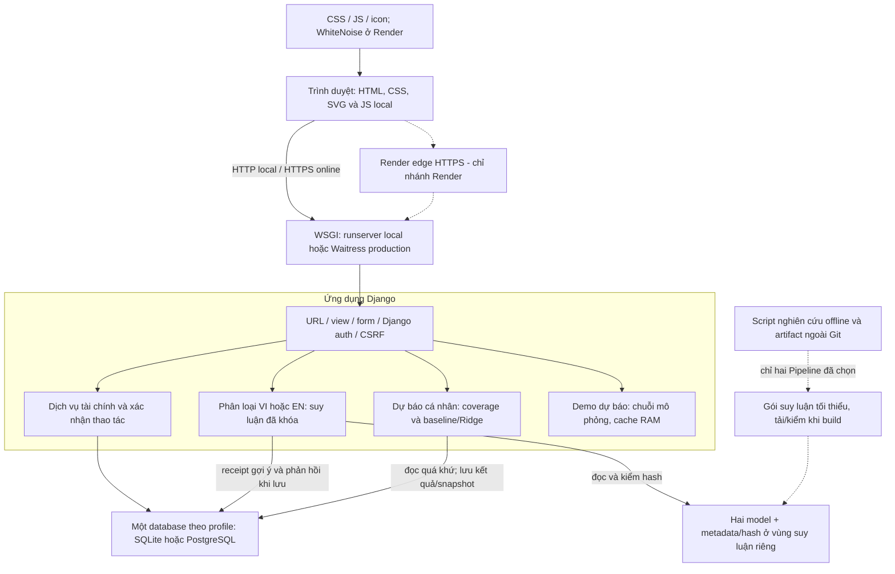
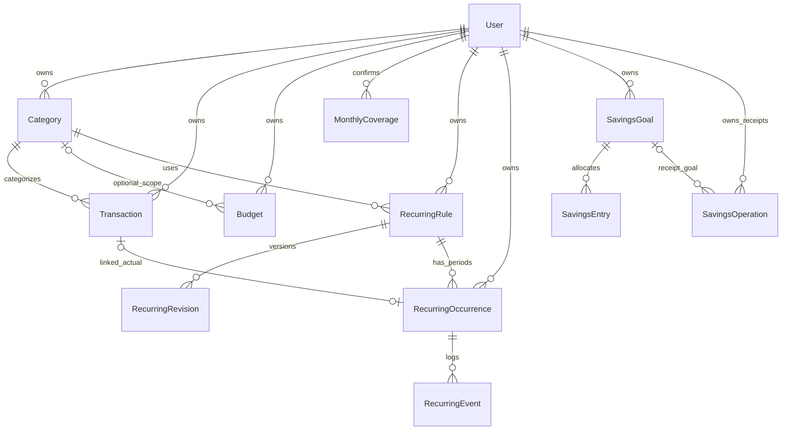
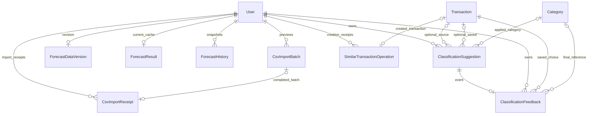

# Kiến trúc Sổ Thu Chi

TASK 21B, đối chiếu ngày **30/10/2026**, mã nguồn **main — `c628a642077ccc26db4c6e1ddc1349b67f4c57e9`**. Không có AGENTS.md trong repository/thư mục cha trực tiếp; working tree sạch lúc bắt đầu. Đây là mô tả từ mã, tài liệu và metadata, không phải lần truy cập hệ thống online hoặc kiểm database đang chạy.

## 1. Công nghệ có căn cứ

| Thành phần | Cấu hình/phiên bản được ghi nhận | Nguồn tra cứu |
|---|---|---|
| Python | **3.13.16** được khóa; không suy runtime online từ tệp này | [`.python-version`](../.python-version), đầu [requirements.txt](../requirements.txt) |
| Web | **Django 5.2.18**, Django templates, HTML/CSS/SVG và JavaScript local; không tách SPA/frontend | [requirements.txt](../requirements.txt), [config/base.py](../config/base.py), [templates/base.html](../templates/base.html), [static](../static) |
| Dữ liệu local | SQLite, `BASE_DIR / db.sqlite3`; version SQLite không khóa trong requirements, **chưa xác minh ở TASK 21B** | [config/local.py](../config/local.py), chỉ đọc mã, không import cấu hình |
| Dữ liệu Render | PostgreSQL bắt buộc qua `DATABASE_URL`; dj-database-url **3.1.2**, psycopg/psycopg-binary **3.3.6**; không fallback SQLite | [config/render.py](../config/render.py), [requirements-render.txt](../requirements-render.txt) |
| Server production | WSGI **Waitress 3.0.2**; Render: 1 process, 2 thread, `0.0.0.0:$PORT`, limit 32 kết nối | [requirements-production.txt](../requirements-production.txt), [scripts/serve_render.py](../scripts/serve_render.py) |
| Static production | **WhiteNoise 6.12.0**, compressed manifest, build `collectstatic`; nội dung tài chính vẫn đọc được khi JS không chạy | [config/render.py](../config/render.py), [deploy/render-build.sh](../deploy/render-build.sh) |
| Xử lý/ML | pandas **3.0.6**, scikit-learn **1.9.1**, numpy **2.5.4**, scipy **1.18.1**, joblib **1.6.0**, threadpoolctl **3.7.0**; pandas phục vụ xử lý dữ liệu, không phải mọi request đều dùng pandas | [requirements.txt](../requirements.txt), runtime trong các [metadata ML](ml-evidence-summary.md) |
| Tiền/ngày | Decimal cho lưu/tổng hợp VND nguyên đồng; Asia/Ho_Chi_Minh. Float64 chỉ tại đại số ML/giá trị vẽ, không dùng thay phép cộng tài chính | [models.Transaction](../finance/models.py#L460), [services.py](../finance/services.py), [money.py](../finance/money.py), [forecast_math.py](../finance/forecast_math.py) |

Các phiên bản trên là dependency/configuration trong repository và runtime thí nghiệm đã lưu. Không chạy pip, không đổi dependency, không xác nhận phiên bản server Render hôm nay.

## 2. Kiến trúc tổng quan

Các cạnh nét đứt là nhánh triển khai/chuẩn bị, không có nghĩa mọi môi trường hoạt động đồng thời. Local đi thẳng WSGI; Render đi qua edge. Demo dùng lại `forecast_math.calculate`, không đọc/ghi giao dịch, coverage hoặc ForecastHistory của người dùng. Không có dịch vụ ML bên ngoài, chatbot, scheduler, Redis/Celery hay API ngân hàng được cấu hình trong các luồng này.

Định tuyến ở [config/urls.py](../config/urls.py), [finance/urls.py](../finance/urls.py). Render HTML cho phần lớn trang; các POST nhập nhanh/gợi ý/Apply trả JSON cho JS của form. Nhập nhanh là parser quy tắc, **không phải mô hình phân loại**. Biểu đồ dùng HTML/CSS/SVG cùng dữ liệu bảng, không có số trang trí.

## 3. Local, QA và triển khai

| Môi trường/profile | Database và server | Cách hiểu bằng chứng |
|---|---|---|
| `config.settings` → `config.local` | SQLite local; hướng dẫn `runserver 127.0.0.1:8001`; artifact theo đường dẫn cấu hình phía server | Chỉ là cấu hình phát triển. TASK 21B không import profile, mở SQLite hoặc khởi chạy website |
| QA | Cấu hình độc lập ngoài repository, database riêng. TASK 21A: SQLite mới, Waitress trên loopback; task trước có PostgreSQL QA | [user-journey-qa.md](user-journey-qa.md) ghi rõ 441 bài Django duy nhất qua hai lượt, 43 JS, browser headless. [postgresql-application-smoke.md](postgresql-application-smoke.md) là bằng chứng lịch sử HTTP/DB QA, không phải online/UI đầy đủ |
| `config.production` | Nhánh cũ: SQLite trên storage bền vững ngoài mã; không phải profile Render | [config/production.py](../config/production.py), [deployment-preparation.md](deployment-preparation.md). Không trình bày nhánh này như cấu hình PostgreSQL online |
| `config.render` | PostgreSQL/TLS `sslmode=require`, Waitress, WhiteNoise, artifact build | [render-deployment.md](render-deployment.md) và script là hợp đồng triển khai. [production-verification.md](production-verification.md) phân biệt lời báo online/bằng chứng QA/chưa xác minh. **Không kiểm online, Dashboard, schema hoặc quyền repository hiện tại trong TASK 21B** |

`production_shared.py` bắt buộc secret/host/origin từ môi trường, DEBUG=False, cookie Secure và HTTPS redirect. Render không tin tùy tiện forwarded headers: `SECURE_PROXY_SSL_HEADER=None`, Waitress gán scheme HTTPS trong profile Render. Đây là giả định triển khai đã ghi, không phải cấu hình dùng cho mọi proxy. Chỉ đọc tên biến trong mã, **không đọc giá trị credential hoặc .env**.

Build chạy cài requirements đã khóa → tải/kiểm ZIP và từng model → collectstatic → deploy check → preflight model. Start chạy preflight, khóa advisory PostgreSQL để migrate, kiểm migration, dọn CSV rồi phục vụ WSGI. Nguồn: [render-build.sh](../deploy/render-build.sh), [render_start.py](../scripts/render_start.py), [serve_render.py](../scripts/serve_render.py). Không chạy các script này ở TASK 21B. Thông báo health check/login hoặc Deploy Live không chứng minh mọi chức năng/ML đã đạt.

## 4. Quan hệ model chính

ER dưới đây đối chiếu trực tiếp **19 model finance** ở [models.py](../finance/models.py), thêm User chuẩn Django làm chủ tài khoản. Chỉ vẽ trường/quan hệ cần giải thích; không phải dump schema/database đang chạy. `o|` là 0 hoặc 1, `o{` là 0 hoặc nhiều. Các quan hệ FK user không thay thế kiểm quyền trong ứng dụng.

### 4.1. Ghi chép và kế hoạch

- `Category.canonical_label` là mã nhãn tùy chọn, không phải FK tới một bảng nhãn hoặc danh mục toàn hệ thống. Tên danh mục không tự suy ra ánh xạ; nhiều danh mục có thể cùng nhãn. Transaction cần danh mục đúng chủ/loại, Decimal >0 và mô tả tối đa 500 ký tự.
- Budget tổng có category=NULL: unique user/month khi NULL; budget danh mục unique user/month/category khi không NULL. Hai mức không cộng thành một hạn mức. MonthlyCoverage unique user/month, lưu status và confirmed_at.
- RecurringOccurrence unique rule/month; transaction OneToOne tùy chọn. Snapshot/revision giữ lịch sử, định danh kỳ khác ngày thực tế. Xóa transaction đặt trạng thái `deleted` qua signal và gỡ liên kết, không tự tạo lại. Dự kiến/bỏ qua không cộng tổng thực tế.
- SavingsEntry thuộc chủ tài khoản **qua goal**, không có user FK riêng. Operation là receipt chống gửi lại; lịch sử được kiểm không âm theo date/ID. Không có FK hoặc cơ chế tự sinh Transaction từ khoản phân bổ.

Nguồn: [models.py#L18](../finance/models.py#L18), [Budget#L325](../finance/models.py#L325), [RecurringRule#L367](../finance/models.py#L367), [signals.py](../finance/signals.py), [savings.py](../finance/savings.py).

### 4.2. ML, lịch sử và receipt nhập liệu

- Suggestion lưu digest đầu vào, mode, nhãn dự đoán, model/hash, seal, TTL và trạng thái Apply/consumed; không sao chép mô tả. Feedback giữ tên danh mục/nhãn cuối tại thời điểm lưu; một suggestion tối đa một feedback, một Transaction có thể có nhiều sự kiện qua các lần sửa có gợi ý mới.
- ForecastResult là cache hiện hành tối đa một dòng/user; ForecastHistory là snapshot append-only **ở tầng ứng dụng**, không phải nhật ký chống sửa tuyệt đối trước mọi quyền SQL. Unique user/target_month/fingerprint/origin chống trùng. Estimate lưu chuỗi số nguyên rồi đọc lại Decimal để không mất chữ số ở SQLite.
- CsvImportBatch giữ payload tạm; CsvImportReceipt unique user/hash, liên kết batch tùy chọn. SimilarTransactionOperation OneToOne tùy chọn tới transaction mới, không lưu source ID hoặc bản sao mô tả.

Nguồn: [Suggestion/Feedback#L94](../finance/models.py#L94), [Forecast#L136](../finance/models.py#L136), [CSV#L251](../finance/models.py#L251), [SimilarTransactionOperation#L510](../finance/models.py#L510).

## 5. Phân quyền và vòng đời dữ liệu

| Điểm kiểm | Cơ chế thực tế | Nguồn |
|---|---|---|
| Tài khoản | Django User/auth/session, login_required; đăng ký không auto-login; POST logout | [config/urls.py](../config/urls.py), [views.signup#L128](../finance/views.py#L128) |
| Danh sách/chi tiết | Lọc request.user; get_object_or_404(pk, user); không nhận user_id đích từ form | [views#L164](../finance/views.py#L164), [financial_calendar.owned_rows](../finance/financial_calendar.py), [monthly_report_views.py](../finance/monthly_report_views.py) |
| Danh mục khi lưu | Queryset form theo user; model.clean kiểm user và kind; một số service đọc/khóa lại sau validation | [forms#L79](../finance/forms.py#L79), [Transaction#L460](../finance/models.py#L460), [similar_transactions.save](../finance/similar_transactions.py#L46) |
| Gợi ý/Apply/Save | UUID theo chủ, TTL/seal/digest/model identity; category cùng user/kind/label; lưu atomic | [classification_feedback.py](../finance/classification_feedback.py), [views.category_suggestion#L83](../finance/views.py#L83) |
| CSV/tiết kiệm/định kỳ | Lô/goal/rule theo user; kiểm lại tại POST; receipt/unique/transaction ở service | [csv_views.py](../finance/csv_views.py), [csv_import#L196](../finance/csv_import.py#L196), [savings_views.py](../finance/savings_views.py), [recurring.py](../finance/recurring.py) |
| Biến đổi dữ liệu | CSRF middleware/form token, validation phía server, escape template; JS khóa nút chỉ hỗ trợ UX | [config/base.py](../config/base.py), [form-feedback.js](../static/js/form-feedback.js) |

Không có policy PostgreSQL Row-Level Security được cấu hình trong mã đã đọc; FK đơn lẻ không tự chứng minh category và transaction cùng user. Không coi việc biết ID là quyền truy cập. Quyền ứng dụng cần được giữ ở mọi đường ghi; raw SQL ngoài luồng không được tuyên bố có cùng bảo đảm như form/service.

Xóa tài khoản cascade dữ liệu sở hữu; SavingsEntry/Event/Revision đi theo goal/occurrence/rule. Category đang được giao dịch/ngân sách/quy tắc dùng có PROTECT. Feedback có snapshot tên/nhãn, category reference SET_NULL khi được xóa hợp lệ; xóa transaction hoặc tài khoản xóa feedback theo CASCADE. Dọn suggestion chỉ xóa gợi ý hết hạn chưa consumed; không dùng feedback làm dữ liệu huấn luyện.

## 6. Lưu trữ và vận hành

Các đường dẫn ổ đĩa tuyệt đối trong tài liệu là **tài liệu tham chiếu local** trên máy thực hiện. Các vùng `data/`, `.render-private/` và tệp QA/bằng chứng ngoài Git không được phát hành cùng repository; người đọc GitHub không thể truy cập chúng bằng các đường dẫn này. Liên kết tương đối tới mã nguồn, tài liệu và metadata được theo dõi trong Git mới là nguồn tra cứu trực tiếp trên repository.

| Dữ liệu | Nơi lưu/cách tồn tại |
|---|---|
| Giao dịch, coverage, feedback, kết quả và lịch sử | Database theo profile; Render dùng PostgreSQL, không đặt trên filesystem tạm của web |
| CSV preview | BinaryField ở database, TTL 30 phút; xác nhận thành công xóa raw/category_bindings. Dọn khi upload và lệnh cleanup; startup Render có cleanup_csv_imports. Không giả định scheduler luôn chạy |
| Hai Pipeline suy luận | Local: các đường dẫn data/ đã khóa. Render: `.render-private/inference/{en,vi}/...`, ngoài static và Git; kiểm hash trước deserialize, cache RAM theo process |
| Static | `.render-static`, collectstatic + hash/gzip; chỉ chứa asset công khai |
| Demo và cache model | RAM process, mất khi restart; không được coi là dữ liệu bền vững hoặc cache riêng tư dùng chung |
| Dataset/thí nghiệm | `data/` ngoài Git, không nhập vào database website hoặc đưa toàn bộ lên server. Chỉ gói hai model + metadata/manifest/requirements cần suy luận |

Gói build được tạo bởi [build_inference_bundle.py](../scripts/build_inference_bundle.py), đóng ZIP qua [package_inference_bundle.py](../scripts/package_inference_bundle.py), tải từ GitHub Release đã định danh qua [download_inference_bundle.py](../scripts/download_inference_bundle.py). Script yêu cầu biến token phía máy chủ, kiểm hash ZIP/từng model và chống đường dẫn ZIP vượt đích; không đọc token ở TASK 21B. Quyền repository/asset hiện tại **chưa kiểm trong task này**, không suy tính riêng tư chỉ từ tên “private” trong tài liệu cũ.

Backup/restore có quy trình riêng: SQLite backup API và PostgreSQL pg_dump/pg_restore vào QA, xem [production-verification.md](production-verification.md), [postgresql-restore-rehearsal.md](postgresql-restore-rehearsal.md). Không chạy backup/restore hoặc kết nối database ở TASK 21B.

Giới hạn: mô tả này không phải kiểm tải, chứng nhận bảo mật, kiểm thiết bị vật lý hoặc xác nhận hệ thống online hiện tại. Các bằng chứng nghiên cứu và giới hạn khái quát hóa nằm ở [ml-evidence-summary.md](ml-evidence-summary.md); các nhánh nghiệp vụ ở [ml-data-flows.md](ml-data-flows.md).

## 7. Kiểm tra tài liệu TASK 21B

Bốn tài liệu và liên kết README được kiểm đường dẫn tương đối, phạm vi số dòng, cấu trúc bảng và JSON Pointer tới nguồn kết quả. **7 sơ đồ Mermaid** được parse bằng Mermaid 11.12.0 tạm ngoài repository; đây là kiểm cú pháp, không phải thử giao diện website hoặc mọi renderer Mermaid. Các chỉ số làm tròn được đối chiếu JSON; 16 tệp artifact được kiểm hash, không deserialize/fit/predict. Báo cáo kiểm tra ngoài Git: `D:\POSTGRESQL QA\task21b-docs-20261030\documentation-check.json`, `mermaid-syntax-check.json`, `artifact-evidence-check.json`. Không chạy lại suite ứng dụng vì chỉ đổi tài liệu; không mở database, đọc .env/credential hoặc truy cập production.
